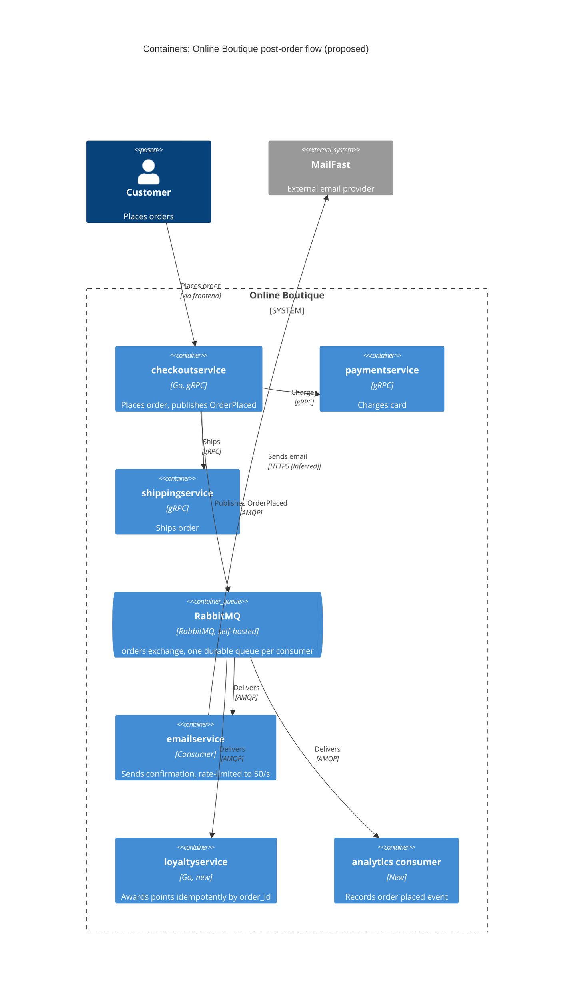

> Agent: Claude Code · Model: Claude Opus 5.5 (`claude-opus-5-5`) · Task 2, run b (with context)

# ADR-0002: Publish an "order placed" event to RabbitMQ for post-order actions

- **Status:** Proposed
- **Date:** 2026-10-21
- **Deciders:** ยสินทร สันนิภางกูร

## Context and problem

Requirement R-12 (`docs/scenario.md`) กำหนดว่าหลังจากลูกค้าสั่งซื้อ ระบบต้อง (1) ส่งอีเมลยืนยันผ่าน **MailFast** แทน logic จำลองใน `emailservice` (2) มอบ loyalty points ผ่าน `loyaltyservice` ใหม่ (3) บันทึก analytics event "order placed" ให้ทีมการตลาด และทีมการตลาดคาดว่าปีหน้าจะมี **post-order action เพิ่มอีก** (SMS, fraud scoring, recommendations update)

**สถานะปัจจุบันจากโค้ด:**

| ข้อเท็จจริง | หลักฐาน |
|---|---|
| `PlaceOrder` เรียก `paymentservice` → `shippingservice` → `cartservice` → `emailservice` ตามลำดับแบบ synchronous gRPC | `system/online-boutique/src/checkoutservice/main.go` (`PlaceOrder`, บรรทัด 252, 258, 263, 273) |
| ถ้าส่งอีเมลล้มเหลว จะแค่ log warning และคำสั่งซื้อยังสำเร็จ | `main.go` บรรทัด 273–277 (`log.Warnf("failed to send order confirmation ...")`) |
| การเรียก `emailservice` ใช้ `ctx` ของ request โดยไม่มี timeout แยก จึง block response จนกว่าอีเมลจะตอบกลับ | `main.go` (`sendOrderConfirmation`, บรรทัด 379–384) |
| dependency ทุกตัวถูกผูกตอน start ผ่าน env var + `mustConnGRPC`; ต้องแก้โค้ดและ deploy ใหม่ทุกครั้งที่เพิ่ม dependency | `main.go` (`checkoutService` struct, `mustMapEnv(..., "EMAIL_SERVICE_ADDR")`, บรรทัด 66–86, 110–123) |
| มี `orderID` (UUID) ที่สร้างขึ้นต่อคำสั่งซื้อ ใช้เป็น idempotency key ได้ | `main.go` (`uuid.NewUUID()`, บรรทัด 233) |
| `checkoutservice` ไม่มี data store ของตัวเอง | Not evidenced in the provided files ว่ามี DB ใดๆ ใน `main.go` |

**ตัวเลขที่สำคัญ (`docs/scenario.md`):**

| หัวข้อ | ค่า | ผลต่อการตัดสินใจ |
|---|---|---|
| Checkout latency | p95 ≤ **500 ms** (ปัจจุบันประมาณ 300 ms) | เหลือ budget ประมาณ 200 ms |
| MailFast latency | p95 **1.5 s**, p99 **8 s** | เรียก MailFast แบบ synchronous ใน `PlaceOrder` จะทำให้ p95 เกิน 500 ms ทันที |
| MailFast failure | ประมาณ **0.5 %** ของการเรียก | ต้องมี retry |
| Peak vs MailFast rate limit | **200 orders/s** vs **50 emails/s** | ช่วง peak มีอีเมลค้างเพิ่มขึ้น 150 ฉบับ/วินาที (9,000 ฉบับต่อ peak 1 นาที) จึงต้องมี buffer [สมมติว่า peak ยาว 1นาที]|
| Loyalty points | ภายใน **1 นาที**, **exactly once** | ต้องมี delivery guarantee + การกันซ้ำ |
| Availability | คำสั่งซื้อต้อง **ไม่ล้มเหลว** เพราะ email, loyalty หรือ analytics ล่ม | ต้องแยก post-order action ออกจาก critical path |
| Team | 4 คน; เก่ง Go และ gRPC; **2 คนเคยใช้ RabbitMQ** | |
| Operations | Kubernetes; ชอบ **open-source, self-hosted** | ตัด managed cloud queue ออก |

**ปัญหา:** จะเชื่อม `checkoutservice` กับ post-order action ทั้งสาม (และที่จะเพิ่มในอนาคต) อย่างไร ให้ checkout ยังเร็วและพร้อมใช้งาน ขณะที่ loyalty points ถูกมอบครบหนึ่งครั้งพอดี และอีเมลไม่เกิน rate limit ของ MailFast

## Decision drivers

1. **Availability:** คำสั่งซื้อต้องไม่ล้มเหลวเพราะ email, loyalty หรือ analytics ล่ม
2. **Performance:** p95 ของ `PlaceOrder` ≤ 500 ms ที่ 200 orders/s
3. **Reliability / correctness:** loyalty points ภายใน 1 นาที แบบ exactly once; อีเมลต้องไม่หายแม้ MailFast ล้มเหลว 0.5 % หรือติด rate limit 50/s
4. **Modifiability:** เพิ่ม post-order action ใหม่ (SMS, fraud scoring, recommendations) โดยไม่ต้องแก้ `checkoutservice` ทุกครั้ง
5. **Cost / operability:** ทีม 4 คนต้องดูแลไหว; open-source, self-hosted บน Kubernetes; ใช้ทักษะที่ทีมมีอยู่ (Go, gRPC, RabbitMQ)

## Considered options

1. **Synchronous gRPC fan-out:** ขยายรูปแบบเดิม ให้ `PlaceOrder` เรียก `emailservice` (MailFast), `loyaltyservice` และ analytics ต่อกันแบบ synchronous
2. **In-process async (goroutine fire-and-forget):** `PlaceOrder` ตอบลูกค้าทันที แล้วยิง gRPC ไปยังทั้งสามบริการใน goroutine พร้อม retry ในหน่วยความจำ
3. **Event-driven ผ่าน RabbitMQ (self-hosted):** `checkoutservice` publish event `OrderPlaced` ไปที่ exchange; consumer แต่ละตัว (`emailservice`→MailFast, `loyaltyservice`, analytics) มี queue ของตัวเอง
4. **Event-driven ผ่าน Apache Kafka (self-hosted):** แบบเดียวกับข้อ 3 แต่ใช้ Kafka topic และ consumer group

### Pros and cons of the options

| Option | Pros | Cons |
|---|---|---|
| 1. Sync gRPC | ง่ายที่สุด; ตรงกับรูปแบบเดิมและทักษะ gRPC ของทีม; ไม่มี component ใหม่ | MailFast p95 1.5 s / p99 8 s ทำให้ p95 เกิน 500 ms; ที่ 200 orders/s จะชน rate limit 50/s; ต้องแก้ `checkoutservice` ทุกครั้งที่เพิ่ม action; ถ้าไม่ใช้ timeout ที่เหมาะสม บริการล่มจะลาก checkout ช้าตาม |
| 2. Goroutine async | latency ของ checkout ไม่ขึ้นกับ MailFast; ไม่มี infrastructure ใหม่ | งานค้างอยู่ในหน่วยความจำ: pod restart แล้ว event หาย จึงรับประกัน loyalty "exactly once" ไม่ได้; ช่วง peak มีอีเมลค้างเพิ่ม 150/s ใน memory ของแต่ละ replica; rate limit 50/s ต้องประสานกันข้าม replica; ยัง couple กับทุก consumer |
| 3. RabbitMQ | แยก post-order action ออกจาก critical path (availability); durable queue ทำหน้าที่เป็น buffer ระหว่าง 200/s กับ 50/s; consumer ack + retry/dead-letter queue รองรับ MailFast ล้มเหลว 0.5 %; เพิ่ม action ใหม่ด้วยการผูก queue ใหม่เข้ากับ exchange โดยไม่แก้ checkout (modifiability); open-source, self-hosted; ทีม 2 คนเคยใช้ | component stateful ใหม่ที่ต้องดูแล (cluster, quorum queues, monitoring); delivery เป็น at-least-once จึงต้องทำ idempotency ใน `loyaltyservice` เอง; ถ้า publish ล้มเหลวหลังตัดบัตรแล้ว event อาจหาย หากไม่มี outbox |
| 4. Kafka | throughput สูง; เก็บ log ไว้ replay ได้ (เป็นประโยชน์ต่อ analytics และ consumer ในอนาคต); open-source | ทีมไม่มีประสบการณ์ (Not evidenced ว่าใครเคยใช้); ดูแลยากกว่าสำหรับทีม 4 คน; 200 msg/s เล็กมากเมื่อเทียบกับจุดแข็งของ Kafka; การจำกัดอัตรา 50/s และ retry ต่อข้อความต้องเขียนเองมากกว่า |

## Decision

เลือก **Option 3: Event-driven ผ่าน RabbitMQ (self-hosted บน Kubernetes)**

- `checkoutservice.PlaceOrder` ทำ payment และ shipping แบบ synchronous เหมือนเดิม จากนั้น **publish event `OrderPlaced`** (มี `order_id`, email, items, total) ไปยัง exchange `orders` โดยใช้ publisher confirms และแทนที่การเรียก `sendOrderConfirmation` แบบ synchronous (`main.go` บรรทัด 273–277)
- ถ้า publish ล้มเหลว คำสั่งซื้อ **ยังสำเร็จ** (คงพฤติกรรมเดิมที่แค่ log warning) และ retry ต่อ
- consumer แต่ละตัวมี durable queue ของตัวเอง:
  - **`emailservice`** กลายเป็น consumer ที่เรียก MailFast โดยจำกัดอัตราที่ ≤ 50 emails/s (prefetch + rate limiter), retry ด้วย backoff และส่งไป dead-letter queue เมื่อล้มเหลวซ้ำ
  - **`loyaltyservice`** (ใหม่, Go) ใช้ `order_id` เป็น idempotency key (unique constraint ใน store ของตัวเอง) เพื่อให้ได้ผลแบบ **exactly once** บน delivery แบบ at-least-once
  - **analytics consumer** บันทึก event ให้ทีมการตลาด
- action ในอนาคต (SMS, fraud scoring, recommendations) เพิ่มได้ด้วยการผูก queue ใหม่เข้ากับ exchange โดยไม่ต้องแก้ `checkoutservice`

**เหตุผล:** เป็นตัวเลือกเดียวที่ตอบ driver 1–3 ได้พร้อมกัน: แยก MailFast (p99 8 s) ออกจาก latency ของ checkout, ใช้ queue เป็น buffer ระหว่าง 200 orders/s กับ 50 emails/s และเก็บ event ไว้อย่าง durable จนกว่า `loyaltyservice` จะ ack ส่วน Kafka ก็ตอบได้เช่นกัน แต่ RabbitMQ ตรงกับ driver 5 มากกว่า (ทีมมีประสบการณ์ และปริมาณงานเล็ก) ในรูปแบบเดียวกับ ADR-0001 ที่เลือก Redis แบบ in-cluster แทนบริการ managed (`docs/adr/0001-use-redis-for-cart-storage.md`)

## Consequences

- **Positive:** การล่มของ email, loyalty หรือ analytics ไม่ทำให้คำสั่งซื้อล้มเหลว (quality attribute: availability)
- **Positive:** latency ของ MailFast (p95 1.5 s, p99 8 s) ไม่อยู่บน critical path ของ `PlaceOrder` อีกต่อไป; เหลือเพียงการ publish หนึ่งครั้ง (quality attribute: performance)
- **Positive:** queue รองรับอีเมลที่ค้างช่วง peak (เพิ่ม 150/s) และระบายที่ 50/s; retry/DLQ รองรับความล้มเหลว 0.5 % (quality attribute: reliability)
- **Positive:** เพิ่ม post-order action ใหม่ได้โดยไม่แก้ `checkoutservice` (quality attribute: modifiability)
- **Negative:** มี component stateful ใหม่ที่ต้อง deploy, monitor และ upgrade โดยทีม 4 คน (quality attribute: cost / operability)
- **Negative:** อีเมลยืนยันอาจถึงลูกค้าช้าในช่วง peak; ระบายงานที่ค้างจาก peak 1 นาทีต้องใช้เวลาประมาณ 3 นาที (9,000 / 50) (quality attribute: performance / usability) [สมมติว่า peak ยาว 1นาที]
- **Negative:** ระบบเป็น eventually consistent และ debug ข้ามบริการยากขึ้น (quality attribute: testability / observability)
- **Risks and mitigations:**
  - *Event หายถ้า publish ล้มเหลวหลังตัดบัตรแล้ว* → ใช้ publisher confirms + retry; ถ้าต้องการรับประกันเต็มรูป ให้ใช้ **transactional outbox** แต่ `checkoutservice` ไม่มี DB (Not evidenced in the provided files) จึงต้องตัดสินใจเพิ่ม (ดู Open questions)
  - *Loyalty points ซ้ำจากการ redeliver* → idempotency key `order_id` ใน `loyaltyservice` (`main.go` บรรทัด 233 สร้าง UUID ต่อคำสั่งซื้อ)
  - *RabbitMQ เป็น single point of failure ของ post-order action* → ใช้ RabbitMQ cluster 3 node กับ quorum queues บน Kubernetes **[Inferred]**; checkout ยังสำเร็จแม้ broker ล่ม
  - *Loyalty ไม่ทัน 1 นาทีช่วง peak* → scale `loyaltyservice` ตาม queue depth และ alert เมื่อ message age เกินกว่าค่าที่กำหนด **[Inferred: ค่า threshold ยังไม่ได้กำหนด]**
  - *ทีมมีประสบการณ์ RabbitMQ แค่ 2 คน* → pair กับสมาชิกอีก 2 คน และเขียน runbook

## Validation

- **Load test** ที่ 200 orders/s (เช่นด้วย Locust `loadgenerator` แบบเดียวกับ ADR-0001): ตรวจว่า p95 ของ `PlaceOrder` ≤ 500 ms
- **Loyalty SLA:** วัด lag ตั้งแต่ publish จนถึงการมอบแต้ม; p100 < 1 นาทีที่ peak; ตรวจ reconciliation ว่าจำนวน order = จำนวนการมอบแต้ม (ไม่มีซ้ำ ไม่มีหาย)
- **Chaos test:** ปิด MailFast (จำลอง), `loyaltyservice`, analytics และ RabbitMQ ทีละตัว แล้วตรวจว่าคำสั่งซื้อยังสำเร็จ 100 %
- **Email:** ตรวจว่าอัตราการเรียก MailFast ไม่เกิน 50/s และ DLQ ว่างหรือได้รับการจัดการ
- **Review date:** ทบทวน ADR นี้ก่อนเพิ่ม post-order action ตัวแรกในปีหน้า หรือหลังการขาย 11.11 ครั้งแรก

## Open questions

- ช่วง peak 200 orders/s ยาวนานเท่าใด? (ใช้คำนวณขนาด queue และเวลาระบายอีเมล)
- มี SLA ว่าลูกค้าต้องได้อีเมลยืนยันภายในเวลาเท่าใด?
- MailFast รองรับ idempotency key หรือไม่? (ถ้าไม่ การ retry อาจทำให้ลูกค้าได้อีเมลซ้ำ) และใช้โปรโตคอลอะไร? (Not evidenced in the provided files)
- ยอมรับการเพิ่ม DB ให้ `checkoutservice` เพื่อทำ transactional outbox ได้หรือไม่ หรือยอมรับความเสี่ยงที่ event อาจหายเมื่อ publish ล้มเหลวหลังตัดบัตร?
- `loyaltyservice` จะใช้ data store อะไรเก็บแต้มและ idempotency key? ต้องรองรับกี่ request/s?
- ทีมการตลาดต้องการ analytics event ในรูปแบบใด และส่งไปเก็บที่ไหน (data warehouse ไหน)? ต้อง replay event ย้อนหลังได้หรือไม่? (ถ้าใช่ Kafka อาจเหมาะกว่า)
- Budget latency ของการ publish ไปยัง RabbitMQ ภายใน cluster: Not evidenced in the provided files ต้องวัดจริง
- ใครเป็นผู้ตัดสินใจ (Deciders) และใครดูแล RabbitMQ ใน production?
- "Exactly once" นับตามอะไร: ต่อ `order_id` หรือมีกรณียกเลิก/คืนเงินที่ต้องหักแต้มคืนด้วย?
