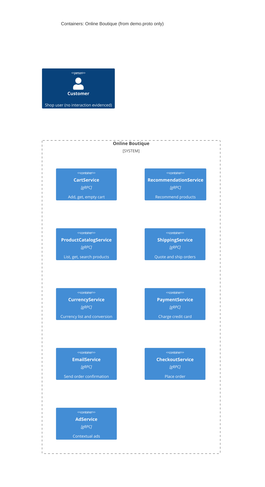

# Task 1 · Run A: Recovered architecture (evidence: `demo.proto` only)

## 1. Agent

Claude Code (Anthropic), model Claude Opus 5.5 (`claude-opus-5-5`).

## 2. Files read

- `prompts/1-recover-architecture.md` (task file)
- `system/online-boutique/protos/demo.proto` (the only evidence)

## 3. Containers table

The proto defines 9 gRPC services in package `hipstershop` (`demo.proto` line 17). I treat each one as a container. The proto does not show any implementation language. `option go_package` (line 19) only sets where generated Go code goes, so it does not prove a service is written in Go.

| Container | Technology / language | Responsibility (from RPCs) | Evidence |
|---|---|---|---|
| CartService | gRPC (proto3); language not evidenced | Add items, get cart, empty cart per `user_id` | `system/online-boutique/protos/demo.proto` (`service CartService`, l.23–27) |
| RecommendationService | gRPC (proto3); language not evidenced | Recommend product IDs for a user and a set of products | `system/online-boutique/protos/demo.proto` (`service RecommendationService`, l.56–58) |
| ProductCatalogService | gRPC (proto3); language not evidenced | List, get and search products (id, name, picture, `price_usd`, categories) | `system/online-boutique/protos/demo.proto` (`service ProductCatalogService`, l.71–75) |
| ShippingService | gRPC (proto3); language not evidenced | Quote shipping cost; ship order and return `tracking_id` | `system/online-boutique/protos/demo.proto` (`service ShippingService`, l.107–110) |
| CurrencyService | gRPC (proto3); language not evidenced | List supported currencies; convert `Money` between ISO 4217 codes | `system/online-boutique/protos/demo.proto` (`service CurrencyService`, l.140–143) |
| PaymentService | gRPC (proto3); language not evidenced | Charge a credit card and return `transaction_id` | `system/online-boutique/protos/demo.proto` (`service PaymentService`, l.177–179) |
| EmailService | gRPC (proto3); language not evidenced | Send order confirmation email | `system/online-boutique/protos/demo.proto` (`service EmailService`, l.199–201) |
| CheckoutService | gRPC (proto3); language not evidenced | Place an order (user, currency, address, email, card), return `OrderResult` | `system/online-boutique/protos/demo.proto` (`service CheckoutService`, l.224–226) |
| AdService | gRPC (proto3); language not evidenced | Return ads for page context keywords | `system/online-boutique/protos/demo.proto` (`service AdService`, l.243–245) |

Data stores: **Not evidenced in the provided files.**

## 4. Dependencies table

A `.proto` file declares the interface each service *offers*. It does not say who *calls* it. So the evidence proves no caller → callee dependency.

| Caller → callee | Protocol | Evidence |
|---|---|---|
| *None evidenced* | — | Not evidenced in the provided files |

All callees would be reached over gRPC, since every service above is declared as a gRPC `service`. The callers are the unknown part. See **Gaps**.

## 5. Mermaid diagram

The diagram has no `Rel` lines because the dependencies table is empty. The `Person` is there because the template requires it. No user-facing container (e.g. a web frontend) or user relationship is evidenced.

## 6. Gaps

| Gap | Why it is unknown | File that would settle it |
|---|---|---|
| Who calls whom (all runtime dependencies) | A proto declares servers, not clients | `system/online-boutique/kubernetes-manifests/*.yaml` (`*_SERVICE_ADDR` env vars); service source code (e.g. `src/checkoutservice/main.go`) |
| **[Inferred]** CheckoutService → Cart, ProductCatalog, Currency, Shipping, Payment, Email | `PlaceOrderRequest` carries `CreditCardInfo`, `Address` and `email`, and `OrderResult` carries `shipping_tracking_id` and `Money` costs. These fit the other services' RPCs, but the proto does not prove the calls. | `src/checkoutservice` source; `kubernetes-manifests/checkoutservice.yaml` |
| **[Inferred]** A web frontend that calls these services and serves the customer | No frontend service is in the proto. Something must call `PlaceOrder`, `GetAds`, etc. | `kubernetes-manifests/frontend.yaml`; `src/frontend` |
| **[Inferred]** RecommendationService → ProductCatalogService | It returns `product_ids` and may need the catalog to pick them | `src/recommendationservice` source |
| Implementation language of each service | Proto is language-neutral (`go_package` only configures Go codegen) | Each `src/<service>/` folder (Dockerfile, source files) |
| Data stores (e.g. where carts are kept) | No storage is declared | `kubernetes-manifests/` (e.g. a Redis deployment); `src/cartservice` source |
| External systems (real payment gateway, email/SMTP provider) | `Charge` and `SendOrderConfirmation` may be internal or may call out | `src/paymentservice`, `src/emailservice` source |
| Ports, deployment units, replicas | Not part of a proto | `kubernetes-manifests/` or Helm charts |
