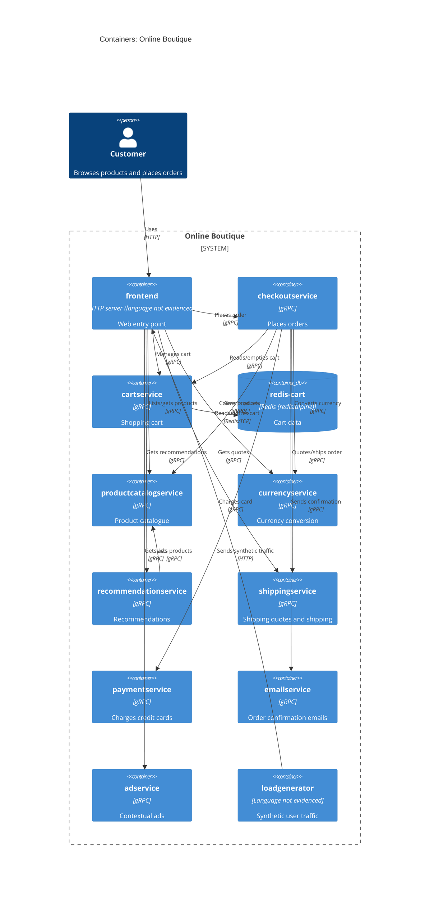

# Task 1 – Recovered architecture (run B)

## 1. Agent

Claude Code (Anthropic), model Claude Opus 5.5 (`claude-opus-5-5`).

## 2. Files read

`prompts/1-recover-architecture.md` (task file) / `system/online-boutique/protos/demo.proto` / `system/online-boutique/kubernetes-manifests/kustomization.yaml` / `system/online-boutique/kubernetes-manifests/README.md` / `system/online-boutique/kubernetes-manifests/adservice.yaml` / `system/online-boutique/kubernetes-manifests/cartservice.yaml` / `system/online-boutique/kubernetes-manifests/checkoutservice.yaml` / `system/online-boutique/kubernetes-manifests/currencyservice.yaml` / `system/online-boutique/kubernetes-manifests/emailservice.yaml` / `system/online-boutique/kubernetes-manifests/frontend.yaml` / `system/online-boutique/kubernetes-manifests/loadgenerator.yaml` / `system/online-boutique/kubernetes-manifests/paymentservice.yaml` / `system/online-boutique/kubernetes-manifests/productcatalogservice.yaml` / `system/online-boutique/kubernetes-manifests/recommendationservice.yaml` / `system/online-boutique/kubernetes-manifests/shippingservice.yaml`

Manifest files were found via the `resources` list in `kustomization.yaml` (plus the commented-out `loadgenerator.yaml` and `README.md`); no directory listing was run.

## 3. Containers table

Implementation language is **Not evidenced in the provided files** for any of the services: the manifests only give unversioned image names (e.g. `image: frontend`), and the proto is language-neutral.

| Container | Technology / language | Responsibility | Evidence |
|---|---|---|---|
| `frontend` | Language not evidenced; HTTP server on port 8080, exposed via `LoadBalancer` | Web entry point for shoppers. Calls the backend services | `kubernetes-manifests/frontend.yaml` (Service `frontend-external`, `type: LoadBalancer`; port name `http`; probe `httpGet /_healthz`) |
| `cartservice` | Language not evidenced; gRPC server on port 7070 | Shopping cart: `AddItem`, `GetCart`, `EmptyCart` | `protos/demo.proto` (`service CartService`); `kubernetes-manifests/cartservice.yaml` (port name `grpc`, 7070) |
| `redis-cart` | Redis (`image: redis:alpine`), `emptyDir` volume at `/data` | Cart data store | `kubernetes-manifests/cartservice.yaml` (Deployment `redis-cart`, `image: redis:alpine`, `volumes: redis-data emptyDir`) |
| `productcatalogservice` | Language not evidenced; gRPC on port 3550 | Product catalogue: `ListProducts`, `GetProduct`, `SearchProducts` | `protos/demo.proto` (`service ProductCatalogService`); `kubernetes-manifests/productcatalogservice.yaml` |
| `currencyservice` | Language not evidenced; gRPC on port 7000 | Currency conversion: `GetSupportedCurrencies`, `Convert` | `protos/demo.proto` (`service CurrencyService`); `kubernetes-manifests/currencyservice.yaml` |
| `recommendationservice` | Language not evidenced; gRPC on port 8080 | Product recommendations: `ListRecommendations` | `protos/demo.proto` (`service RecommendationService`); `kubernetes-manifests/recommendationservice.yaml` |
| `shippingservice` | Language not evidenced; gRPC on port 50051 | Shipping quotes and order shipping: `GetQuote`, `ShipOrder` | `protos/demo.proto` (`service ShippingService`); `kubernetes-manifests/shippingservice.yaml` |
| `checkoutservice` | Language not evidenced; gRPC on port 5050 | Places orders: `PlaceOrder`. Coordinates cart, catalogue, currency, shipping, payment and email | `protos/demo.proto` (`service CheckoutService`); `kubernetes-manifests/checkoutservice.yaml` |
| `paymentservice` | Language not evidenced; gRPC on port 50051 | Charges a credit card: `Charge` | `protos/demo.proto` (`service PaymentService`); `kubernetes-manifests/paymentservice.yaml` |
| `emailservice` | Language not evidenced; gRPC (Service port 5000 → container 8080) | Sends order confirmations: `SendOrderConfirmation` | `protos/demo.proto` (`service EmailService`); `kubernetes-manifests/emailservice.yaml` |
| `adservice` | Language not evidenced; gRPC on port 9555 | Contextual ads: `GetAds` | `protos/demo.proto` (`service AdService`); `kubernetes-manifests/adservice.yaml` |
| `loadgenerator` | Language not evidenced (init container uses `busybox`/`wget`) | Generates synthetic user traffic against the frontend (`USERS=10`, `RATE=1`). Commented out of `kustomization.yaml` | `kubernetes-manifests/loadgenerator.yaml`; `kubernetes-manifests/kustomization.yaml` (`# - loadgenerator.yaml`) |

## 4. Dependencies table

How the protocol is evidenced: each callee's K8s Service names its port `grpc` and uses `grpc` readiness/liveness probes, and its interface is a `service` in `demo.proto`. Which RPCs a given caller actually invokes is **not** evidenced; the manifests only show that the caller is configured with the address.

| Caller → callee | Protocol | Evidence |
|---|---|---|
| Customer → `frontend` | HTTP | `kubernetes-manifests/frontend.yaml` (Service `frontend-external`, `LoadBalancer`, port name `http` 80→8080) |
| `loadgenerator` → `frontend` | HTTP | `kubernetes-manifests/loadgenerator.yaml` (`FRONTEND_ADDR=frontend:80`; init container `wget http://${FRONTEND_ADDR}`) |
| `frontend` → `productcatalogservice` | gRPC | `kubernetes-manifests/frontend.yaml` (`PRODUCT_CATALOG_SERVICE_ADDR=productcatalogservice:3550`) |
| `frontend` → `currencyservice` | gRPC | `kubernetes-manifests/frontend.yaml` (`CURRENCY_SERVICE_ADDR=currencyservice:7000`) |
| `frontend` → `cartservice` | gRPC | `kubernetes-manifests/frontend.yaml` (`CART_SERVICE_ADDR=cartservice:7070`) |
| `frontend` → `recommendationservice` | gRPC | `kubernetes-manifests/frontend.yaml` (`RECOMMENDATION_SERVICE_ADDR=recommendationservice:8080`) |
| `frontend` → `shippingservice` | gRPC | `kubernetes-manifests/frontend.yaml` (`SHIPPING_SERVICE_ADDR=shippingservice:50051`) |
| `frontend` → `checkoutservice` | gRPC | `kubernetes-manifests/frontend.yaml` (`CHECKOUT_SERVICE_ADDR=checkoutservice:5050`) |
| `frontend` → `adservice` | gRPC | `kubernetes-manifests/frontend.yaml` (`AD_SERVICE_ADDR=adservice:9555`) |
| `checkoutservice` → `productcatalogservice` | gRPC | `kubernetes-manifests/checkoutservice.yaml` (`PRODUCT_CATALOG_SERVICE_ADDR=productcatalogservice:3550`) |
| `checkoutservice` → `shippingservice` | gRPC | `kubernetes-manifests/checkoutservice.yaml` (`SHIPPING_SERVICE_ADDR=shippingservice:50051`) |
| `checkoutservice` → `paymentservice` | gRPC | `kubernetes-manifests/checkoutservice.yaml` (`PAYMENT_SERVICE_ADDR=paymentservice:50051`) |
| `checkoutservice` → `emailservice` | gRPC | `kubernetes-manifests/checkoutservice.yaml` (`EMAIL_SERVICE_ADDR=emailservice:5000`) |
| `checkoutservice` → `currencyservice` | gRPC | `kubernetes-manifests/checkoutservice.yaml` (`CURRENCY_SERVICE_ADDR=currencyservice:7000`) |
| `checkoutservice` → `cartservice` | gRPC | `kubernetes-manifests/checkoutservice.yaml` (`CART_SERVICE_ADDR=cartservice:7070`) |
| `recommendationservice` → `productcatalogservice` | gRPC | `kubernetes-manifests/recommendationservice.yaml` (`PRODUCT_CATALOG_SERVICE_ADDR=productcatalogservice:3550`) |
| `cartservice` → `redis-cart` | Redis protocol over TCP | `kubernetes-manifests/cartservice.yaml` (`REDIS_ADDR=redis-cart:6379`; Service port name `tcp-redis`) |

## 5. Mermaid diagram

The `Rel` labels give the likely purpose, based on the RPC names in `demo.proto`. **[Inferred]**: the manifests do not show which RPCs each caller uses.

## 6. Gaps

| Gap | What would settle it |
|---|---|
| Implementation language/framework of every service | Each service's source/Dockerfile, e.g. `system/online-boutique/src/<service>/Dockerfile` |
| `shoppingassistantservice`: `frontend.yaml` sets `SHOPPING_ASSISTANT_SERVICE_ADDR=shoppingassistantservice:80`, but no manifest for it is in `kustomization.yaml` (`# ../kustomize/components/shopping-assistant` is commented out; `ENABLE_ASSISTANT` is commented out). Left out of the diagram | `system/online-boutique/kustomize/components/shopping-assistant/` |
| Optional "packaging service" (`PACKAGING_SERVICE_URL`, commented out in `frontend.yaml`). Left out | Frontend source, e.g. `system/online-boutique/src/frontend/` |
| Which RPCs each caller actually invokes, and whether every configured address is really used | Caller source code (e.g. `src/frontend/`, `src/checkoutservice/`) |
| Data stores for `productcatalogservice`, `currencyservice`, `adservice`, etc. (none shown; might be in-process/static data) | Their source under `system/online-boutique/src/` |
| Whether `paymentservice` / `emailservice` call real external systems (card processor, SMTP). No `System_Ext` is evidenced | `src/paymentservice/`, `src/emailservice/` |
| Alternative data stores (Memorystore, AlloyDB, Spanner) and network policies, all commented out in `kustomization.yaml` `components` | `system/online-boutique/kustomize/components/` |
| Durability of cart data: `redis-cart` uses an `emptyDir` volume, so data is likely lost if the pod is rescheduled **[Inferred]** | Kubernetes `emptyDir` semantics / ops docs |
| Whether `loadgenerator` is part of the deployed system (it is commented out of `kustomization.yaml`; the comment says skaffold uses it during development) | `system/online-boutique/skaffold.yaml` |
| Whether the manifests folder holds other files besides those named in `kustomization.yaml` (no directory listing was run) | A directory listing of `kubernetes-manifests/` |
